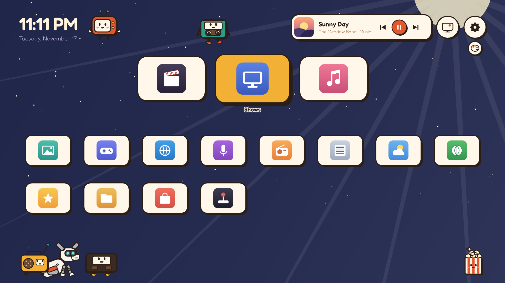
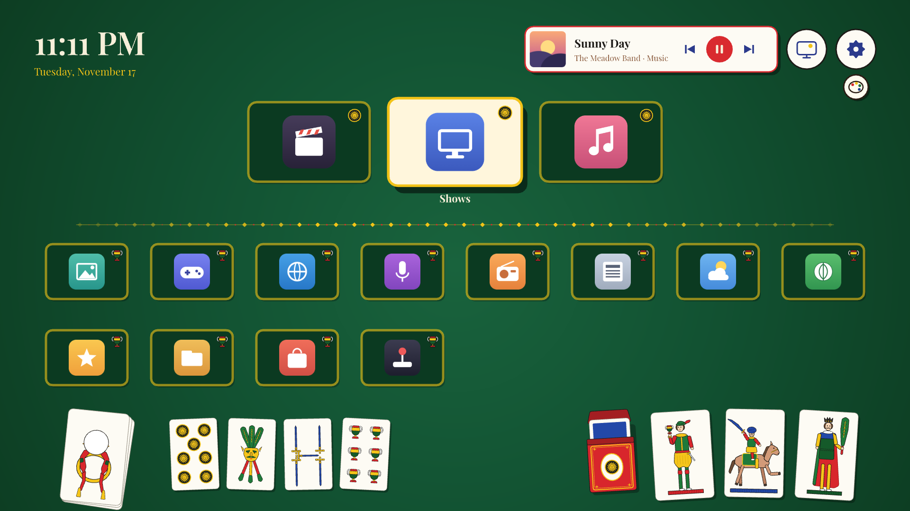
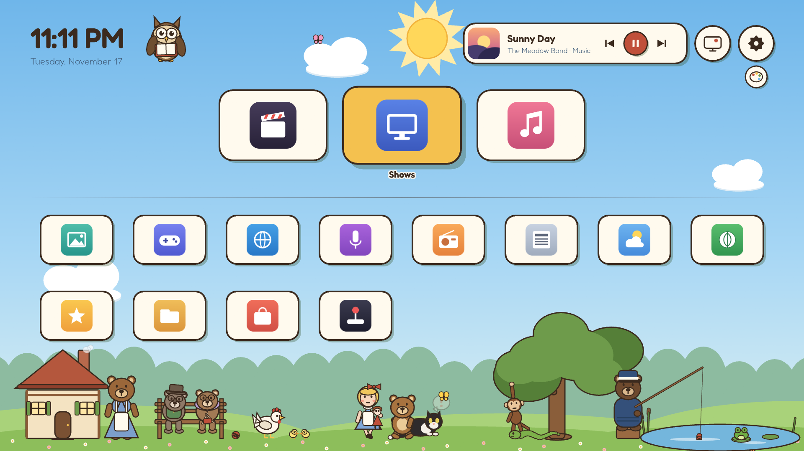
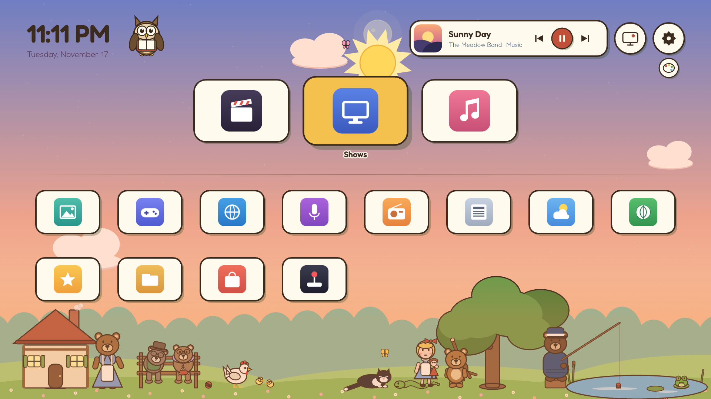
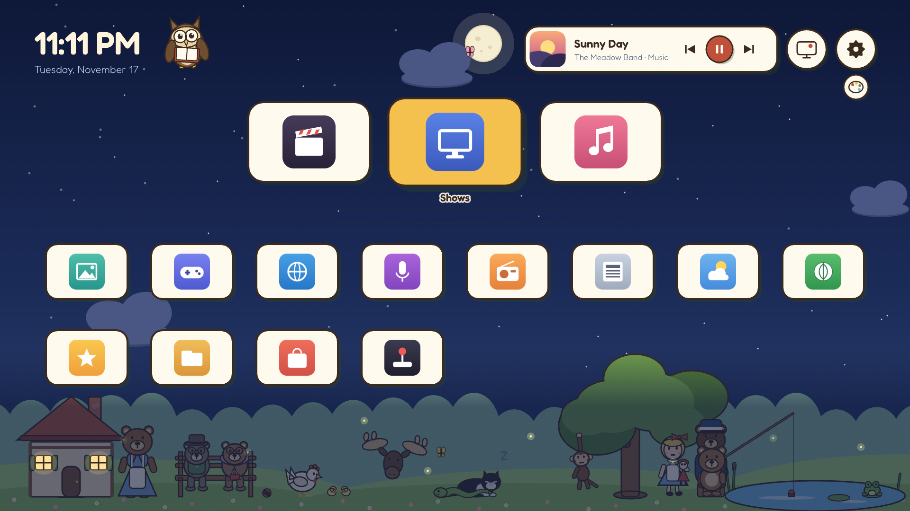

# DiLaunchero

Custom Android TV / Google TV home launcher (`com.jdileonardo.dilaunchero`).

Just a really bare bones launcher for my own TV because i can't stand the default garbage; absolutely bare minimum :)

- Now Playing (any app that reports what it's playing, with prev / play-pause / next)
- Shortcut to Screensaver so i can see my photos play (starts it straight away)
- Settings (Android settings, screensaver settings)
- Favourites at the top
- Themes: the home screen is drawn in [Rive](https://rive.app); pick one with the palette button under the gear
- Day, dusk and night: Retro and Little Bear follow the sun (sunrise and sunset worked out from the TV's time zone; no location needed)

## Themes

**Default**


**Retro**: cream paper, thick ink, and a cast of characters wandering about (a TV guy, a cassette, a record, popcorn, a radio, a VHS tape, a handheld, a camera, and a robot pup scooting on its bum)


…and after dark:



**Scopa**: a green felt table and a Neapolitan deck; the court cards come alive and every so often someone sweeps the table (scopa!)



**Little Bear**: a sunny day in the woods with the whole gang, after the Little Bear books and TV show (our own caricatures). Owl reads beside the clock; Mother Bear waves from the Bear house; Grandfather Bear dozes and Grandmother Bear knits on their bench; Hen fusses with her chicks; Cat naps (and now and then: boo!); Mitzi swings from the big tree; Father Bear fishes the pond with Frog and an otter; Moose peeks over the hill; Little Bear and Emily (with Lucy), Duck, Tutu and No Feet wander past



At dusk the sun goes down; at night the moon and stars come out, the Bear house lights its lamps and the fireflies come out over the meadow:





## Remote

- OK opens; hold OK on an app for options (open, favourite, move, app info)
- Up from the favourites reaches Now Playing and the buttons; down from the gear reaches the theme button

## Working on the themes

Each theme is its own Rive project in `rive-ui/themes/<name>/` (sharing icons, art, fonts and the data model the app drives). Preview one with `rive .` inside its folder, then build them all into the app:

```
python3 rive-ui/tools/build.py        # or: build.py retro
./gradlew assembleDebug
```

The retro cast, the Scopa table and the Little Bear forest are generated by `themes/retro/characters.py`, `themes/scopa/gen_figures.py` and `themes/littlebear/gen_cast.py`. `tools/sky.py` gives a theme its day, dusk and night looks.

ToDo:
- Maybe the weather
