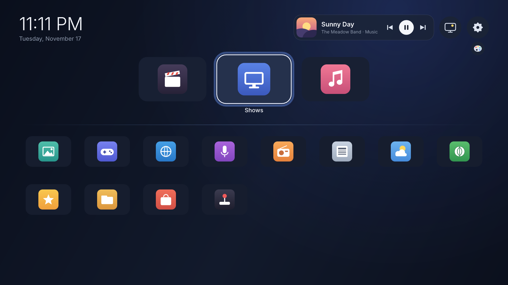
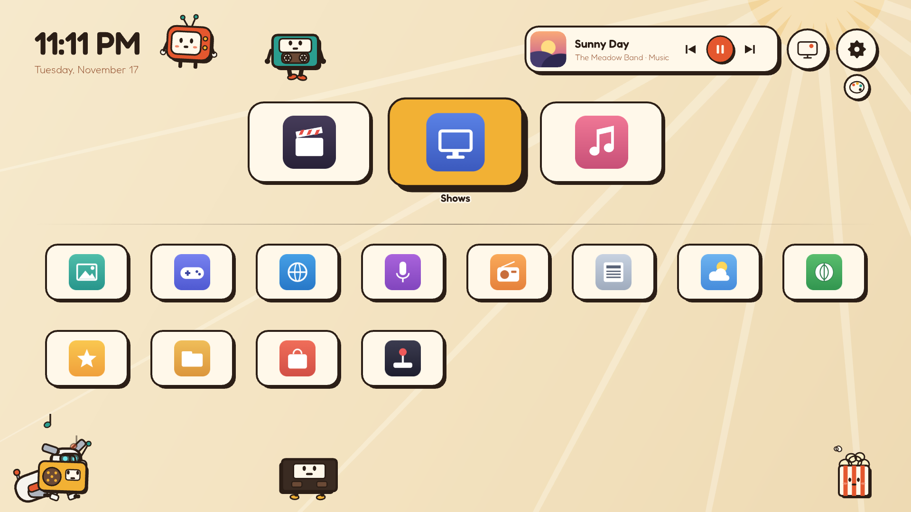

# DiLaunchero

Custom Android TV / Google TV home launcher (`com.jdileonardo.dilaunchero`).

Just a really bare bones launcher for my own TV because i can't stand the default garbage; absolutely bare minimum :)

- Now Playing (any app that reports what it's playing, with prev / play-pause / next)
- Shortcut to Screensaver so i can see my photos play (starts it straight away)
- Settings (Android settings, screensaver settings)
- Favourites at the top
- Themes: the home screen is drawn in [Rive](https://rive.app); pick one with the palette button under the gear

## Themes

**Default**



**Retro**: cream paper, thick ink, and a cast of characters wandering about (a TV guy, a cassette, a record, popcorn, a radio, a VHS tape, a handheld, a camera, and a robot pup scooting on its bum)



**Scopa**: a green felt table and a Neapolitan deck; the court cards come alive and every so often someone sweeps the table (scopa!)


## Remote

- OK opens; hold OK on an app for options (open, favourite, move, app info)
- Up from the favourites reaches Now Playing and the buttons; down from the gear reaches the theme button

## Working on the themes

Each theme is its own Rive project in `rive-ui/themes/<name>/` (sharing icons, art, fonts and the data model the app drives). Preview one with `rive .` inside its folder, then build them all into the app:

```
python3 rive-ui/tools/build.py        # or: build.py retro
./gradlew assembleDebug
```

The retro cast and the Scopa table are generated by `themes/retro/characters.py` and `themes/scopa/gen_figures.py`.

ToDo:
- Maybe the weather
